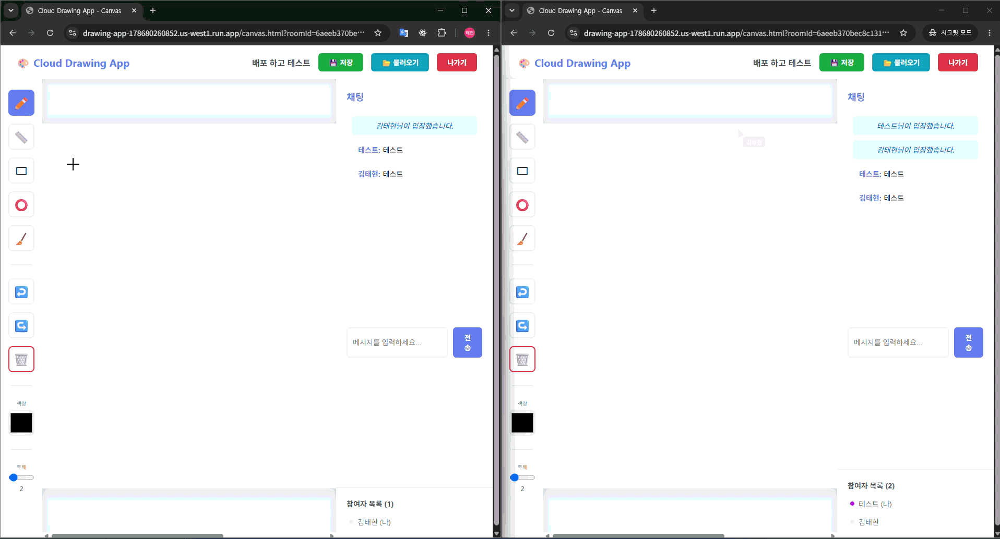
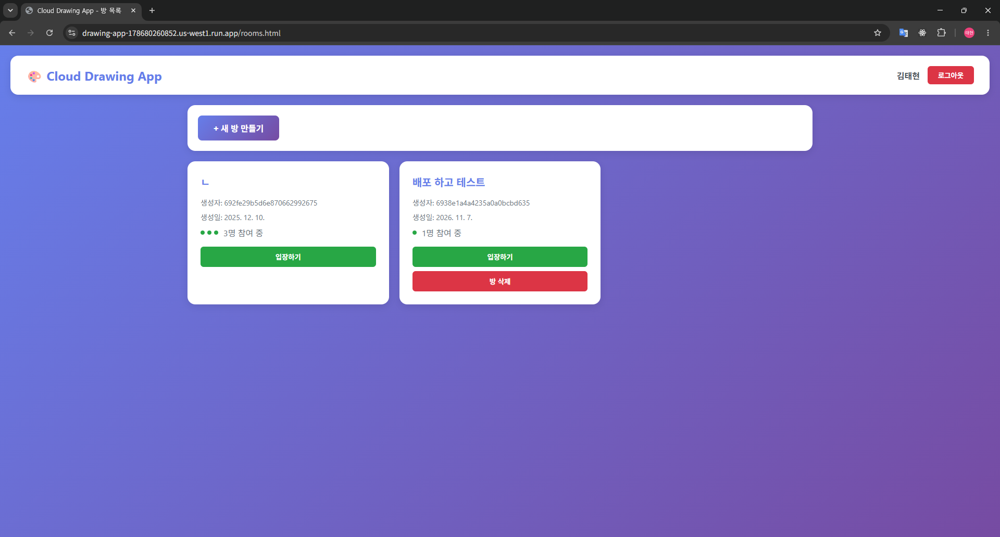

# Cloud Drawing

> 방을 만들고 친구를 초대해서 **한 캔버스에 같이 그리는** 실시간 협업 드로잉 웹 서비스입니다.
> 그리는 즉시 모든 참여자 화면에 반영되고, 채팅과 캔버스 저장까지 지원합니다.

* * *

## Screenshot

### 시연 영상


### 방 목록


* * *

## 접속

**[Cloud Drawing](https://drawing-app-178680260852.us-west1.run.app/)**

```
https://drawing-app-178680260852.us-west1.run.app/
```

회원가입 후 방을 만들거나 기존 방에 입장하면 바로 그릴 수 있습니다.

> 서버가 유휴 상태일 때는 꺼져 있다가 첫 요청에 켜지므로, 첫 접속은 10~20초 정도 걸릴 수 있습니다.

* * *

## 프로젝트 한 줄 요약

- **무엇을**: 여러 명이 동시에 그리는 실시간 협업 드로잉 + 채팅
- **왜**: 떨어져 있어도 한 화면에서 같이 그리며 아이디어를 공유하기 위해
- **어떻게**: WebSocket(STOMP)으로 드로잉 이벤트를 방 단위로 브로드캐스트하고, 캔버스는 MongoDB에 저장합니다.

* * *

## 주요 기능

| 영역 | 내용 |
|---|---|
| 회원 | 회원가입/로그인, 비밀번호는 BCrypt로 암호화 |
| 방 | 방 생성·목록 조회(5초 자동 새로고침)·입장/퇴장·삭제 |
| 드로잉 | 펜(자유 곡선), 직선, 사각형, 원, 지우개, 색상 선택, 선 두께(1~20) |
| 실시간 동기화 | 그리는 즉시 같은 방의 다른 사용자 화면에 반영 |
| 채팅 | 방별 실시간 채팅, 입장/퇴장 알림 |
| 저장 | 캔버스를 PNG(Base64)로 MongoDB에 저장하고 최근 저장본 불러오기 |
| 안정성 | 전역 예외 처리, WebSocket 자동 재연결 |

### 구현하지 않은 기능
실행 취소/다시 실행, 전체 지우기, 커서 위치 공유, 참여자 목록(UI만 있음)은 아직 구현되지 않았습니다.

* * *

## 주요 문서

| 문서 | 무슨 내용 | 언제 보면 되나 |
|---|---|---|
| **[`product.md`](product.md)** | 개발 단계별 계획·진행 상황, DB 스키마 | 구조와 진행 상황을 볼 때 |
| **[`Dockerfile`](Dockerfile)** | 컨테이너 빌드·실행 설정 | 배포할 때 |

* * *

## 기술 스택

| 분야 | 기술 |
|---|---|
| 백엔드 |    |
| 실시간 통신 |   |
| 프론트엔드 |   |
| 데이터베이스 |  |
| 배포 |   |

* * *

## 설계 포인트

- **방 단위 메시지 라우팅**: `/topic/room/{roomId}/draw`, `/topic/room/{roomId}/chat`을 구독해 같은 방 사용자에게만 전달합니다.
- **S3 대신 MongoDB 저장**: 캔버스를 Base64 PNG로 `CanvasHistory`에 저장해 별도 스토리지 설정 없이 바로 쓸 수 있게 했습니다. 이미지 용량이 커지면 저장소만 교체하면 됩니다.
- **비밀 정보 분리**: DB 접속 주소는 코드에 두지 않고 환경변수 `MONGODB_URI`로 주입합니다.
- **단일 인스턴스 배포**: 메시지 중계가 서버 메모리의 STOMP 브로커에서 이뤄지므로 Cloud Run 인스턴스를 1개로 제한했습니다.

* * *

## 폴더 구조

```
java_pj/
├─ src/main/java/com/cloudproject/drawing/
│  ├─ config/        # WebSocket · Security · MongoDB 설정
│  ├─ controller/    # REST(auth, rooms, canvas, users) · WebSocket 메시지 컨트롤러
│  ├─ service/       # 인증 · 방 · 캔버스 비즈니스 로직
│  ├─ repository/    # MongoDB 접근 계층
│  ├─ model/         # User · Room · CanvasHistory · DrawingData
│  ├─ dto/           # 요청/응답/메시지 객체
│  ├─ listener/      # WebSocket 연결·해제 이벤트
│  └─ exception/     # 예외 처리
├─ src/main/resources/
│  ├─ application.yml
│  └─ static/        # index · rooms · canvas (HTML/JS)
├─ Dockerfile  docker-compose.yml  build.gradle
└─ product.md
```

* * *

## 실행 방법

### 로컬 실행

```bash
# MongoDB 접속 주소 지정 (생략하면 localhost:27017 사용)
export MONGODB_URI="mongodb+srv://<사용자>:<비밀번호>@<클러스터>/drawing-app"

./gradlew bootRun
```

서버는 `http://localhost:8080`에서 실행됩니다.

### Docker로 실행 (MongoDB 포함)

```bash
docker-compose up --build
```

### 배포 (Google Cloud Run)

```bash
gcloud run deploy drawing-app --source . --region us-west1 \
  --memory 1Gi --min-instances 0 --max-instances 1 \
  --set-secrets MONGODB_URI=<시크릿 이름>:latest
```

> DB 계정 정보는 저장소에 올리지 않고 Secret Manager 등으로 주입합니다.
